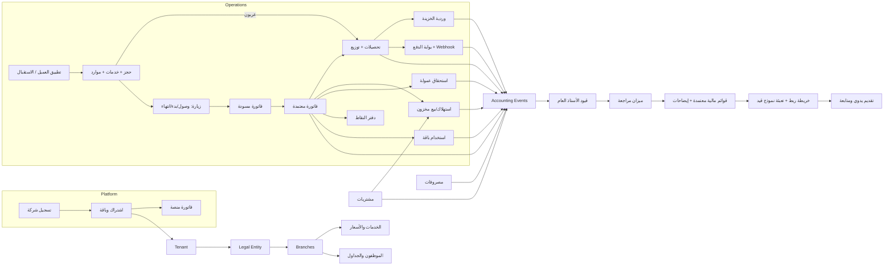

# قصّة POS — Qassa POS
## وثيقة التحليل والتصميم المعماري (الإصدار 0.1)

> **حالة الوثيقة:** مسودة للمراجعة. القيود المحاسبية والسياسات الواردة هنا **مقترحات** تحتاج اعتماد محاسب مؤهل قبل التشغيل، وما يخص منظومة «قيد» مبني على المطلوب في الطلب فقط إلى أن يتوفر النموذج والدليل الرسميان.
>
> **التقنية المعتمدة (حسب طلب المالك):** Backend بلغة Python، واجهات الويب React على Node.js، وتطبيق العملاء Flutter. هذا يحل محل اقتراح Laravel الوارد في الطلب الأصلي.

---

## 1. نتيجة فحص الديمو

تم فحص الملفات الفعلية في `salon-pos-demo/` (الإصدار المسلَّم قبل هذه الوثيقة). الديمو **تطبيق صفحة واحدة بدون خادم**، كل منطقه في المتصفح، ومصدر الحقيقة فيه `localStorage`.

### 1.1 ملاحظات حرجة (تمنع اعتباره أساسًا إنتاجيًا)

| # | الملاحظة | الدليل في الملفات |
|---|---|---|
| 1 | كل البيانات في `localStorage` بمفتاح لكل نوع نشاط؛ لا خادم ولا قاعدة بيانات | `js/data/seeds.js` (`KEY`, `skey()`), `js/core/business-types.js` (`loadBiz`, `save`) |
| 2 | كلمات المرور والـPIN مخزنة نصًا صريحًا داخل الكود، والتحقق يتم في المتصفح | `js/data/seeds.js` (`mkStaff` … `pass:'123456'`), `js/core/auth-nav.js` (`tryLogin`, `findUser`) |
| 3 | الصلاحيات تُفرض في الواجهة فقط (`allowed()`)، ويمكن تجاوزها من أدوات المطور | `js/core/auth-nav.js` (`allowed`, `CASHIER_PAGES`, `MGR_PAGES`) |
| 4 | «العزل» بين الشركات = تحميل ملف بيانات مختلف؛ لا يوجد عزل فعلي | `js/core/business-types.js` (`findUser` يقرأ كل الشركات) |
| 5 | الفاتورة كائن واحد يجمع البيع والتحصيل والخصم والنقاط؛ لا فصل بين الفاتورة والتحصيل | `js/modules/pos.js` (`checkout` → `sale={…pay,paid,prepaid…}`) |
| 6 | الترقيم `++S.seq` في المتصفح؛ يتكرر مع أكثر من جهاز | `js/modules/pos.js` (`checkout`) |
| 7 | الأموال بأرقام `float` في JavaScript، والتقريب عند العرض فقط | `js/core/helpers.js` (`fmt`), `js/modules/pos.js` (`calc`) |
| 8 | الإلغاء = علامة `void:true` على نفس السجل؛ لا مستند تصحيح | `js/modules/invoices.js` (`voidSale`) |
| 9 | التوريد يُسجَّل **مصروفًا** وفي نفس الوقت يُحسب **تكلفة مبيعات** في التقارير → ازدواج في التكلفة | `js/modules/services-stock.js` (`restock` → `S.expenses.push`), `js/modules/reports.js` (`cogs`) |
| 10 | النقاط محسوبة من الفواتير لا من دفتر حركات (`ptsLog` جزئي فقط) | `js/modules/loyalty.js` (`kidPoints`) |
| 11 | العميل مُعرّف بالاسم أو الهاتف (`kidKey`) | `js/core/helpers.js` (`kidKey`), `js/modules/customers.js` |
| 12 | الدفع الإلكتروني محاكاة بـ`setTimeout` | `js/apps/customer-app.js` (`caPay`, `caGateway`) |
| 13 | OTP وهمي (أي 4 أرقام) | `js/apps/customer-app.js` (`caLoginGo`) |
| 14 | الحجز خدمة واحدة لموظف واحد، ومنع التعارض في المتصفح فقط | `js/modules/bookings.js`, `js/apps/customer-app.js` (`caSlots`) |
| 15 | الترجمة استبدال نصوص بعد العرض بـ`MutationObserver` | `js/core/i18n.js`, `js/i18n/en.js` |
| 16 | أسعار الباقات وبيانات الشركات ثابتة في الكود | `js/platform/platform.js` (`PL.plans`, `PL.tenants`) |
| 17 | لا محاسبة بالقيد المزدوج إطلاقًا؛ «صافي الربح» = مبيعات − مصروفات − عمولات | `js/modules/reports.js` (`renderRep`) |

### 1.2 ما يستحق الحفاظ عليه

- **الهوية البصرية:** متغيرات الألوان والمكونات وخط Alexandria — `assets/css/base.css`، `assets/fonts/`.
- **ثيمات الأنشطة:** `assets/css/themes.css` (أطفال أخضر، رجالي ذهبي، نسائي وردي).
- **تجربة الكاشير على التابلت:** تخطيط أفقي/رأسي، لوحة أرقام، طابور قابل للنقر — `assets/css/tablet.css`، `js/apps/tablet-pos.js`.
- **رسومات الخدمات SVG:** `js/ui/service-art.js` (تُنقل لمكوّن React).
- **تدفقات المستخدم:** الحجز بخمس خطوات مع الخدمة المنزلية والدفع (`js/apps/customer-app.js`)، لوحة صاحب الشركة والفروع (`js/modules/company.js`)، صفحة الأسعار المتغذية من الإعدادات (`js/apps/pricing-site.js`).
- **قاموس المصطلحات:** نصوص `js/i18n/en.js` كمصدر أولي لملفات الترجمة بالمفاتيح.

---

## 2. خريطة الفرق بين الديمو والمنتج

الأولوية: **P0** أساس لا يعمل شيء بدونه · **P1** المرحلة التشغيلية الأولى · **P2** لاحق · **P3** حسب الطلب.

| الوحدة | الموجود في الديمو | واجهة/محاكاة فقط | قابل لإعادة الاستخدام | يحتاج إعادة بناء | الناقص | الأولوية |
|---|---|---|---|---|---|---|
| المنصة والاشتراكات | شركات، باقات، فواتير اشتراك، تذاكر، دخول دعم | كل شيء ثابت في الكود (`platform.js`) | تصميم الشاشات، صفحة الأسعار | البيانات والحالات والفوترة | رسوم تأسيس، سعر فرع إضافي، إضافات، عقود مخصصة، فترة سماح، تقييد الكتابة، مراقبة | P1 |
| الهوية والدخول | شاشة دخول، أدوار | المصادقة كلها | التصميم | كامل | كلمات مرور مشفرة، جلسات، استعادة، MFA، Rate limiting | **P0** |
| العزل (Tenancy) | ملف بيانات لكل شركة | نعم | — | كامل | Tenant / Legal Entity / Branch / Membership، عزل بالخادم والملفات والطوابير | **P0** |
| الفروع | فروع، اختيار فرع، دخول صاحب الشركة لفرع | البيانات | تجربة التبديل بين الفروع | البيانات | مواعيد عمل، خزائن، مخازن، أجهزة | P1 |
| العملاء/الأطفال | عميل بالاسم والهاتف، ملاحظات | الهوية | الشاشات | النموذج | حساب ≠ مستفيد، ولي أمر بعدة أطفال، موافقات، دمج سجلات، صور بموافقة | P1 |
| الخدمات والتسعير | خدمات، فئات، سعر متغير، رسومات | — | الرسومات، الفئات حسب النشاط | النموذج | سعر حسب فرع/مستوى، سجل أسعار، إضافات، وصفة استهلاك، مهارات الموظف | P1 |
| الحجوزات | خدمة واحدة، طابور، حجز منزلي | منع التعارض | تصميم اللوحة والطابور | كامل | عدة خدمات وموظفين وموارد، أقفال تزامن، حجز مؤقت، عربون، حالات منفصلة | P1 |
| الكاشير | كاشير ويب وتابلت، كوبون، نقاط | الحساب كله في المتصفح | تجربة التابلت بالكامل | المنطق والبيانات | مسودة/اعتماد، خصم سطر، موظف لكل سطر، دفع مختلط/جزئي/آجل، مرتجع، ترقيم آمن | P1 |
| المدفوعات | شاشة KNET وهمية | نعم | تجربة الاختيار | كامل | Adapter لمزود حقيقي، Webhooks، Idempotency، تسوية، رسوم | P1 |
| الخزينة | تقفيل وردية بالمتوقع/الفعلي | الحساب | الشاشة | المنطق | رصيد افتتاحي، قبض/صرف/تحويل، إيداع، اعتماد فروق، إكراميات | P1 |
| المخزون | كمية وحد طلب، توريد | نعم | — | كامل | دفتر حركات، مخازن، وحدات، تحويلات، جرد، تكلفة متوسطة | P2 |
| المشتريات | — | — | — | — | موردون، أوامر شراء، استلام، فواتير، سداد، أعمار ديون | P2 |
| العروض/الكوبونات | عروض، كوبونات بعدّاد | العدّاد غير آمن تزامنيًا | الشاشات | المنطق | حد لكل عميل، حد أقصى للخصم، منع الجمع، حفظ القاعدة المطبقة | P1 |
| الباقات | (غير موجودة؛ العروض تُنفذ فورًا) | — | — | — | باقات جلسات، دفتر استخدام، تجميد، استرداد، التزام محاسبي | P2 |
| الولاء | نقاط ومستويات | محسوبة من الفواتير | الشاشات | كامل | دفتر حركات، انتهاء، عكس عند المرتجع، هدايا مجدولة مرة واحدة | P2 |
| الموظفون والعمولات | نسبة عمولة واحدة | الحساب | — | كامل | قواعد بتاريخ سريان، شرائح، أساس الحساب، اعتماد وصرف، سلف | P2 |
| المصروفات | قائمة مصروفات | — | الشاشة | المنطق | مستند ومرفق، اعتماد، فصل عن السداد، منع التكرار، مركز تكلفة | P1 |
| المحاسبة | لا توجد | — | — | — | كل شيء | **P0 (النواة)** / P2 (الاستكمال) |
| التقارير المالية | تقارير مبيعات | محسوبة من الفواتير | الرسوم البيانية | كامل | من الأستاذ العام، إقفال، مقارنات، إيضاحات | P2 |
| تصدير «قيد» | لا يوجد | — | — | — | كل شيء، ويعتمد على النموذج الرسمي | P3 (يعتمد على جهة خارجية) |
| تطبيق العملاء | معاينة ويب | OTP والدفع | التدفق والتصميم | إعادة بناء بـFlutter | OTP حقيقي، Push، علامة لكل شركة | P2 |
| الإشعارات | wa.me يدوي | — | الإبقاء على wa.me | — | مزود آلي، قوالب، طوابير، موافقات | P2 |
| الترجمة | استبدال نصوص | نعم | نصوص `en.js` | كامل | مفاتيح ثابتة `t('pos.charge')` | **P0** |
| التدقيق | لا يوجد | — | — | — | سجل تدقيق محمي | **P0** |

---

## 3. البنية التقنية المقترحة

### 3.1 القرار

| الطبقة | الاختيار | السبب |
|---|---|---|
| Backend | **Python 3.13 + Django 5.2 LTS + Django REST Framework 3.18** | المحاسبة والتسويات تحتاج ORM ناضجًا بمعاملات وقيود قاعدة بيانات وترحيلات (migrations) موثوقة. Django يوفر المصادقة والجلسات وحماية CSRF ولوحة إدارة جاهزة لفريق صغير. نسخة 5.2 مدعومة حتى أبريل 2028 حسب سياسة Django؛ الترقية إلى 6.2 LTS بعد صدورها. DRF 3.18.3 يدعم 5.2 (من بيانات الحزمة). |
| لماذا ليس FastAPI | — | FastAPI ممتاز للـAPI الخفيف، لكن سنحتاج تجميع ORM وترحيلات ومصادقة وإدارة بأنفسنا، وهذا عبء على فريق صغير في نظام محاسبي. |
| قاعدة البيانات | **PostgreSQL 16+** | `numeric` دقيق للأموال، مفاتيح أجنبية مركبة للعزل، `SELECT … FOR UPDATE` للتزامن، قيود استبعاد (exclusion constraints) لمنع تعارض الحجوزات، ومستقبلًا Row Level Security. |
| الطوابير | **Celery 5 + Redis 7** | Outbox، الإشعارات، الترحيل غير المتزامن، المهام المجدولة (هدايا الميلاد، انتهاء الباقات). |
| API | REST + **OpenAPI 3** عبر drf-spectacular | توثيق تلقائي للـReact وFlutter. |
| الويب | **React 19 + TypeScript + Vite 8** (Node 22) | تطبيق SPA واحد بأدوار متعددة: الكاشير (PWA للتابلت)، الإدارة، المحاسب، المنصة. TanStack Query للبيانات، React Router، **react-i18next بمفاتيح ثابتة**، RTL/LTR حقيقي. |
| صفحة الأسعار العامة | داخل نفس المستودع، صفحات ثابتة تُبنى مسبقًا (prerender) | محركات البحث تحتاج HTML جاهز؛ Next.js غير مبرر في البداية. |
| تطبيق العملاء | **Flutter (stable)** بقاعدة كود واحدة و**Flavors** لكل شركة | علامة لكل شركة بإعدادات build؛ نفس الـAPI. |
| لوحة الإدارة الداخلية | Django Admin (للدعم الفني والمنصة فقط) | سريع لفريق صغير. **لا** يُستخدم للكاشير أو الحجز. |
| الملفات | تخزين متوافق مع S3 (MinIO محليًا) | مفاتيح بمسار `tenants/{tenant_id}/…` وروابط موقعة قصيرة العمر. |
| Excel (نموذج قيد) | **openpyxl** مبدئيًا، ويُحسم بعد اختبار النموذج الرسمي | لا يُفترض أن أي مكتبة تحفظ كل مكونات المصنف؛ اختبار إلزامي على الملف الفعلي. XlsxWriter مستبعد لأنه لا يعدّل ملفًا موجودًا. |
| النشر | Docker Compose (dev/test) وصور Docker للإنتاج | بيئات منفصلة، أسرار من متغيرات البيئة. |

### 3.2 المصادقة

- **الويب (React):** جلسة Django في كوكي `HttpOnly; Secure; SameSite=Lax` + CSRF. أبسط وأأمن من تخزين JWT في المتصفح.
- **Flutter:** Access token قصير (15 دقيقة) + Refresh token بتدوير وإبطال (simplejwt مع blacklist).
- **MFA (TOTP)** إلزامي لأدوار: مالك المنصة، الدعم، مالك الشركة، المدير المالي، المحاسب.
- **العملاء:** دخول برقم الهاتف وOTP عبر مزود SMS قابل للتبديل، بحدود محاولات وإعادة إرسال.
- **PIN الكاشير:** لتبديل المستخدم السريع على جهاز مسجل فقط، وليس بديلًا عن تسجيل الدخول.

### 3.3 العزل بين الشركات (Multi-tenancy)

قاعدة بيانات واحدة ومخطط واحد، مع:

1. **سياق المستأجر يُحدد على الخادم** من عضوية المستخدم المصادق عليه. الواجهة ترسل `X-Tenant` لاختيار شركة **من بين عضوياته فقط**، والخادم يتحقق.
2. **Manager إلزامي** للجداول المعزولة: `TenantScopedModel.objects` يرفض الاستعلام إذا لم يوجد سياق، ويضيف شرط الشركة تلقائيًا. الوصول غير المعزول يتم عبر `all_tenants` صريح ومراقب.
3. **مفاتيح أجنبية مركبة** `(tenant_id, id)` في PostgreSQL: سطر الفاتورة لا يمكن أن يشير لفاتورة من شركة أخرى **على مستوى قاعدة البيانات**، وليس الكود فقط.
4. مهام Celery تحمل `tenant_id` وتعيد بناء السياق.
5. الملفات بمسارات معزولة وروابط موقعة.
6. اختبارات آلية لمنع التسرب (مرحلة 1).
7. لاحقًا: PostgreSQL RLS كطبقة دفاع إضافية.

### 3.4 قواعد عامة

- **المال:** `Decimal` في Python و`numeric(18,3)` في قاعدة البيانات للدينار، `numeric(18,6)` للتكلفة، `numeric(18,4)` للكميات. التقريب `ROUND_HALF_UP` إلى 3 منازل، وفرق التوزيع يذهب لآخر سطر. `float` ممنوع (فحص في الاختبارات).
- **منطق الأعمال** في طبقة `services/` لكل وحدة، لا في الـViews.
- **Idempotency-Key** إلزامي لكل عملية مالية من الواجهة؛ جدول يحفظ المفتاح وبصمة الطلب والاستجابة.
- **Outbox:** كل أثر خارجي (إشعار، ترحيل غير متزامن) يُكتب في نفس المعاملة ويُنفذ لاحقًا مع إعادة محاولة.
- **المستند المعتمد لا يُعدّل:** الإلغاء أو مستند تصحيح فقط.
- **التدقيق:** جدول Append-only مع بصمة متسلسلة (hash chain) لاكتشاف التلاعب.

---

## 4. خريطة الوحدات وتدفق البيانات

### 4.1 الوحدات (Modular Monolith — تطبيقات Django منفصلة)

| الوحدة | المسؤولية | تعتمد على |
|---|---|---|
| `core` | الأموال، الأخطاء، Idempotency، Outbox، الترقيم | — |
| `identity` | المستخدمون، كلمات المرور، MFA، الجلسات، OTP | core |
| `tenancy` | Tenant، LegalEntity، Branch، Membership، الأدوار والصلاحيات، سياق الطلب | identity |
| `audit` | سجل التدقيق | tenancy |
| `platform` | الباقات، الاشتراكات، فواتير المنصة، التذاكر، دخول الدعم | tenancy |
| `crm` | العملاء، المستفيدون، الموافقات، الدمج | tenancy |
| `catalog` | الخدمات، المنتجات، الأسعار، الإضافات، الوصفات | tenancy |
| `staff` | الموظفون، المهارات، الجداول | tenancy, catalog |
| `scheduling` | الحجوزات، الموارد، الطابور، الزيارات | crm, catalog, staff |
| `pos` | الفواتير، السطور، المرتجعات | scheduling, catalog, promotions |
| `payments` | التحصيلات، التوزيع، Adapters، Webhooks، الاسترداد | pos |
| `cash` | الخزائن، الورديات، الحركات النقدية | payments |
| `inventory` | المخازن، دفتر الحركات، التكلفة | catalog |
| `procurement` | الموردون، أوامر الشراء، الاستلام، فواتير المورد | inventory |
| `promotions` | العروض والكوبونات | catalog |
| `loyalty` | دفتر النقاط والمستويات | crm |
| `packages` | الباقات، كروت الهدايا، المحفظة | crm, catalog |
| `commissions` | القواعد، الاستحقاق، الصرف | staff, pos |
| `accounting` | الحسابات، الفترات، القيود، قواعد الترحيل | core, tenancy |
| `reporting` | التقارير التشغيلية والقوائم المالية وإصداراتها | accounting |
| `qayd_export` | النموذج الرسمي، خرائط الربط، التصدير، التقديم | reporting |
| `notifications` | القوالب، القنوات، سجل الإرسال | core |

**قاعدة:** الوحدات التشغيلية لا تكتب في جداول المحاسبة مباشرة. تُصدر **حدثًا محاسبيًا** (`AccountingEvent`) داخل نفس المعاملة، ووحدة `accounting` تحوله لقيد عبر قواعد ترحيل قابلة للإعداد.

### 4.2 التدفق الكامل

---

## 5. ERD مبدئي

أعمدة `tenant_id` موجودة في كل الجداول المعزولة (غير مكررة في الرسم للاختصار). كل الجداول فيها `created_at, updated_at, created_by`.

```mermaid
erDiagram
  TENANT ||--o{ LEGAL_ENTITY : owns
  LEGAL_ENTITY ||--o{ BRANCH : has
  TENANT ||--o{ MEMBERSHIP : grants
  USER ||--o{ MEMBERSHIP : has
  MEMBERSHIP ||--o{ MEMBERSHIP_SCOPE : "branch scope"
  ROLE ||--o{ MEMBERSHIP : assigned
  ROLE ||--o{ ROLE_PERMISSION : includes

  PLAN ||--o{ SUBSCRIPTION : priced
  TENANT ||--o{ SUBSCRIPTION : subscribes
  SUBSCRIPTION ||--o{ PLATFORM_INVOICE : bills

  CUSTOMER_ACCOUNT ||--o{ BENEFICIARY : manages
  CUSTOMER_ACCOUNT ||--o{ CONSENT : gives

  SERVICE ||--o{ SERVICE_PRICE : "effective-dated"
  SERVICE ||--o{ SERVICE_RECIPE_LINE : consumes
  STAFF ||--o{ STAFF_SKILL : can_do

  BOOKING ||--o{ BOOKING_ITEM : contains
  BOOKING_ITEM }o--|| STAFF : assigned
  BOOKING_ITEM }o--o| RESOURCE : uses
  BOOKING_ITEM }o--|| BENEFICIARY : for

  INVOICE ||--o{ INVOICE_LINE : has
  INVOICE }o--o| BOOKING : from
  INVOICE ||--o{ PAYMENT_ALLOCATION : settled_by
  PAYMENT ||--o{ PAYMENT_ALLOCATION : allocates
  PAYMENT }o--o| CASH_SESSION : in
  PAYMENT ||--o{ GATEWAY_EVENT : webhook
  CREDIT_NOTE }o--|| INVOICE : reverses
  CREDIT_NOTE ||--o{ REFUND : paid_by

  PACKAGE_SALE ||--o{ PACKAGE_ENTITLEMENT : grants
  PACKAGE_ENTITLEMENT ||--o{ PACKAGE_USAGE : consumed_by
  LOYALTY_ACCOUNT ||--o{ LOYALTY_TXN : ledger
  WALLET ||--o{ WALLET_TXN : ledger

  WAREHOUSE ||--o{ STOCK_MOVE : ledger
  SUPPLIER ||--o{ PURCHASE_ORDER : orders
  GOODS_RECEIPT ||--o{ STOCK_MOVE : creates
  SUPPLIER_BILL ||--o{ SUPPLIER_PAYMENT_ALLOC : settled_by

  COMMISSION_RULE ||--o{ COMMISSION_ACCRUAL : applied
  COMMISSION_PAYOUT ||--o{ COMMISSION_ACCRUAL : pays

  ACCOUNT ||--o{ JOURNAL_LINE : posted_to
  JOURNAL_ENTRY ||--o{ JOURNAL_LINE : has
  FISCAL_PERIOD ||--o{ JOURNAL_ENTRY : in
  ACCOUNTING_EVENT ||--o| JOURNAL_ENTRY : produces

  REPORT_VERSION ||--o{ STATEMENT_LINE : contains
  QAYD_TEMPLATE ||--o{ QAYD_MAPPING : defines
  QAYD_EXPORT }o--|| REPORT_VERSION : from
  QAYD_EXPORT }o--|| QAYD_TEMPLATE : uses
  QAYD_EXPORT ||--o{ QAYD_SUBMISSION : submitted_as
```

### 5.1 قيود وفهارس جوهرية

| الجدول | القيد / الفهرس | الغرض |
|---|---|---|
| كل الجداول المعزولة | `UNIQUE(tenant_id, id)` + FK مركب `(tenant_id, parent_id)` | منع الربط بين شركتين في قاعدة البيانات |
| `journal_entry` | `UNIQUE(tenant_id, source_type, source_id, event_type)` | منع ترحيل الحدث مرتين |
| `journal_line` | `CHECK (debit >= 0 AND credit >= 0 AND (debit = 0) <> (credit = 0))` | سطر مدين أو دائن فقط |
| `journal_entry` | توازن المدين والدائن يُتحقق في الخدمة + Trigger مؤجل `DEFERRABLE INITIALLY DEFERRED` | لا قيد غير متوازن حتى لو تم الإدخال من خارج الكود |
| `invoice` | `UNIQUE(tenant_id, legal_entity_id, series, number)` | ترقيم فريد |
| `number_sequence` | صف لكل سلسلة يُقفل بـ`SELECT … FOR UPDATE` | ترقيم آمن مع تعدد الكاشيرات |
| `booking_item` | `EXCLUDE USING gist (staff_id WITH =, tstzrange(start,end) WITH &&) WHERE status active` | منع تعارض الموظف على مستوى قاعدة البيانات |
| `booking_item` | نفس القيد على `resource_id` | منع تعارض الكرسي/الغرفة |
| `coupon_redemption` | `UNIQUE(coupon_id, invoice_id)` + قفل الصف عند التحقق من الحد | منع تجاوز الحد بالتزامن |
| `package_usage` | قفل `package_entitlement` + `CHECK(remaining >= 0)` | منع الاستهلاك المزدوج |
| `idempotency_key` | `UNIQUE(tenant_id, key)` | منع تكرار الطلب |
| `gateway_event` | `UNIQUE(provider, provider_event_id)` | Webhook مكرر |
| `audit_log` | Append-only (لا UPDATE/DELETE بصلاحيات قاعدة البيانات) + `prev_hash` | سجل محمي |

### 5.2 الفصل المطلوب في البيانات (ملخص)

- **العميل ≠ المستفيد ≠ ولي الأمر:** `customer_account` (من يدفع ويدخل التطبيق) و`beneficiary` (من تُنفذ له الخدمة؛ قد يكون نفس الشخص). العلاقة `guardian_link` بصلاحية الحجز.
- **الحجز ≠ الفاتورة ≠ الدفع:** ثلاث كيانات بثلاث حالات مستقلة. الحجز يرتبط بالفاتورة بـFK اختياري فريد.
- **الفاتورة ≠ التحصيل:** `payment` منفصل و`payment_allocation` يوزع الدفعة على فاتورة أو أكثر (دفع مختلط/جزئي/آجل).
- **المرتجع ≠ الاسترداد:** `credit_note` (أثر الإيراد) و`refund` (خروج المال) بحالات منفصلة.
- **الإجماليات ليست مصدر الحقيقة:** أرصدة المخزون والنقاط والمحفظة والباقات تُحسب من دفاتر الحركات، مع جداول أرصدة مُجمّعة قابلة لإعادة البناء.

---

## 6. مصفوفة الأحداث والأثر المحاسبي المقترح

> **تنبيه:** هذه **مقترحات** تخضع لاعتماد المحاسب وللإطار المحاسبي المطبق على الكيان. كل حساب هنا **دور حساب** (Account Role) يُربط بحساب فعلي من دليل الحسابات عبر الإعدادات، وليس رقمًا ثابتًا في الكود.

### 6.1 أدوار الحسابات المستخدمة

| الدور | النوع |
|---|---|
| `CASH_DRAWER` (صندوق الفرع) | أصل |
| `BANK` | أصل |
| `KNET_CLEARING` (مستحق من جهاز KNET قبل التسوية) | أصل |
| `GATEWAY_CLEARING` (مستحق من بوابة الدفع) | أصل |
| `AR_CUSTOMERS` (ذمم العملاء — حساب رقابي) | أصل |
| `INVENTORY_RETAIL` / `INVENTORY_SUPPLIES` | أصل |
| `GRNI` (بضاعة مستلمة لم تصل فاتورتها) | التزام |
| `AP_SUPPLIERS` (ذمم الموردين — رقابي) | التزام |
| `CONTRACT_LIABILITY_PACKAGES` (التزام باقات) | التزام |
| `CUSTOMER_DEPOSITS` (عربون) | التزام |
| `CUSTOMER_WALLET` / `GIFT_CARDS` | التزام |
| `TIPS_PAYABLE` (إكراميات للموظفين) | التزام |
| `COMMISSIONS_PAYABLE` | التزام |
| `FIXED_ASSETS` / `ACCUMULATED_DEPRECIATION` | أصل / مقابل أصل |
| `SERVICE_REVENUE` / `PRODUCT_REVENUE` | إيراد |
| `SALES_RETURNS` (مقابل إيراد) | إيراد مدين |
| `SALES_DISCOUNTS` (اختياري حسب السياسة) | إيراد مدين |
| `OTHER_INCOME` (عربون مصادر مثلًا) | إيراد |
| `COGS_PRODUCTS` / `COST_OF_SERVICES_SUPPLIES` | مصروف |
| `COMMISSION_EXPENSE` / `PAYMENT_FEES` / `DEPRECIATION_EXPENSE` / `CASH_OVER_SHORT` | مصروف |

### 6.2 الأمثلة الاثنا عشر

**1) خدمة نقدية بـ5.000 د.ك**
مستندات: فاتورة معتمدة + تحصيل نقدي مرتبط بوردية.

| الحدث | مدين | دائن |
|---|---|---|
| اعتماد الفاتورة | `AR_CUSTOMERS` 5.000 | `SERVICE_REVENUE` 5.000 |
| التحصيل النقدي | `CASH_DRAWER` 5.000 | `AR_CUSTOMERS` 5.000 |

لماذا قيدان وليس واحدًا؟ لأن الفاتورة والتحصيل حدثان منفصلان (قد يختلف توقيتهما أو طريقتهما). يمكن **عرضهما** كقيد واحد في تقرير اليومية المبسط، لكن يُخزنان منفصلين لتبقى المطابقة ممكنة. رصيد `AR_CUSTOMERS` لعميل المرور (walk-in) يعود للصفر.
استثناءات: إلغاء الفاتورة قبل التحصيل ← قيد عكسي؛ بعد التحصيل ← مرتجع + استرداد (مثال 7).

**2) بيع منتج بـ3.000 تكلفته 1.800 (متوسط مرجح)**

| الحدث | مدين | دائن |
|---|---|---|
| الفاتورة | `AR_CUSTOMERS` 3.000 | `PRODUCT_REVENUE` 3.000 |
| تكلفة المبيعات (من حركة المخزون) | `COGS_PRODUCTS` 1.800 | `INVENTORY_RETAIL` 1.800 |
| التحصيل | `CASH_DRAWER` 3.000 | `AR_CUSTOMERS` 3.000 |

التكلفة تُؤخذ من حركة المخزون (`stock_move.unit_cost` لحظة الصرف)، لا من سعر الشراء الأخير.
استثناء: مخزون سالب ← حسب السياسة (منع، أو صرف بتكلفة تقديرية مع قيد تسوية عند الاستلام).

**3) فاتورة 20.000: نقدي 5.000 + KNET 15.000**

| الحدث | مدين | دائن |
|---|---|---|
| الفاتورة | `AR_CUSTOMERS` 20.000 | `SERVICE_REVENUE` 20.000 |
| تحصيل نقدي | `CASH_DRAWER` 5.000 | `AR_CUSTOMERS` 5.000 |
| تحصيل KNET | `KNET_CLEARING` 15.000 | `AR_CUSTOMERS` 15.000 |
| تسوية البنك لاحقًا (رسوم 0.150 مثلًا) | `BANK` 14.850 + `PAYMENT_FEES` 0.150 | `KNET_CLEARING` 15.000 |

جهاز KNET غير متكامل: الكاشير يسجل رقم المرجع (Auth code) يدويًا، والتسوية تُطابق من كشف البنك.

**4) فاتورة آجلة 10.000 ثم تحصيلها**

| الحدث | مدين | دائن |
|---|---|---|
| الفاتورة (بصلاحية «بيع آجل» وحد ائتمان) | `AR_CUSTOMERS` 10.000 (دفتر العميل) | `SERVICE_REVENUE` 10.000 |
| التحصيل لاحقًا | `CASH_DRAWER`/`BANK` 10.000 | `AR_CUSTOMERS` 10.000 |

تقرير أعمار الديون من `payment_allocation`.

**5) بيع باقة بـ30.000 (3 جلسات) ثم استخدام جلسة**

| الحدث | مدين | دائن |
|---|---|---|
| بيع الباقة | `CASH_DRAWER` 30.000 | `CONTRACT_LIABILITY_PACKAGES` 30.000 |
| استخدام جلسة (توزيع 10.000 للجلسة حسب السياسة) | `CONTRACT_LIABILITY_PACKAGES` 10.000 | `SERVICE_REVENUE` 10.000 |
| انتهاء الباقة بجلسة غير مستخدمة | حسب السياسة المعتمدة (إثبات إيراد عند الانتهاء أو بشكل تناسبي) | — |

**التحصيل ≠ الإيراد:** الـ30 تحصيل، الإيراد يُثبت عند تقديم الخدمة. التوزيع على الجلسات يُحفظ في `package_entitlement.allocated_value` لحظة البيع، ولا يتغير بتغير الأسعار لاحقًا.

**6) عربون حجز 2.000**

| الحدث | مدين | دائن |
|---|---|---|
| استلام العربون أونلاين | `GATEWAY_CLEARING` 2.000 | `CUSTOMER_DEPOSITS` 2.000 |
| تنفيذ الخدمة (فاتورة 8.000) | `AR_CUSTOMERS` 8.000 | `SERVICE_REVENUE` 8.000 |
| خصم العربون من الفاتورة | `CUSTOMER_DEPOSITS` 2.000 | `AR_CUSTOMERS` 2.000 |
| تحصيل الباقي | `CASH_DRAWER` 6.000 | `AR_CUSTOMERS` 6.000 |
| *أو* استرداد العربون | `CUSTOMER_DEPOSITS` 2.000 | `GATEWAY_CLEARING` 2.000 |
| *أو* عدم حضور ومصادرة حسب السياسة | `CUSTOMER_DEPOSITS` 2.000 | `OTHER_INCOME` 2.000 |

**7) مرتجع جزئي 2.000 واسترداد نقدي**

| الحدث | مدين | دائن |
|---|---|---|
| إشعار دائن مرتبط بسطر الفاتورة الأصلية | `SALES_RETURNS` 2.000 | `AR_CUSTOMERS` 2.000 |
| الاسترداد النقدي | `AR_CUSTOMERS` 2.000 | `CASH_DRAWER` 2.000 |
| إرجاع منتج سليم للمخزون (إن وجد) | `INVENTORY_RETAIL` بالتكلفة الأصلية | `COGS_PRODUCTS` |
| عكس النقاط والعمولة | أحداث منفصلة في دفاترها | — |

**8) فاتورة مورد آجلة 100.000 ثم سدادها**

| الحدث | مدين | دائن |
|---|---|---|
| استلام البضاعة | `INVENTORY_RETAIL` 100.000 | `GRNI` 100.000 |
| فاتورة المورد | `GRNI` 100.000 | `AP_SUPPLIERS` 100.000 |
| السداد | `AP_SUPPLIERS` 100.000 | `BANK` 100.000 |

**لا يُسجل مصروف عند السداد** (هذا تصحيح لخطأ الديمو في `restock`). فرق سعر الفاتورة عن الاستلام ← حساب فروق أسعار أو تعديل التكلفة حسب السياسة.

**9) استهلاك مستلزمات خدمة (صبغة 0.400)**

| الحدث | مدين | دائن |
|---|---|---|
| حركة مخزون من الوصفة عند إكمال الخدمة | `COST_OF_SERVICES_SUPPLIES` 0.400 | `INVENTORY_SUPPLIES` 0.400 |

**10) عمولة 1.500 ثم صرفها**

| الحدث | مدين | دائن |
|---|---|---|
| اعتماد الاستحقاق (حسب سياسة: عند التنفيذ أو التحصيل) | `COMMISSION_EXPENSE` 1.500 | `COMMISSIONS_PAYABLE` 1.500 |
| الصرف | `COMMISSIONS_PAYABLE` 1.500 | `CASH_DRAWER`/`BANK` 1.500 |

القاعدة المطبقة (النسبة، الأساس، الشريحة) تُنسخ داخل سجل الاستحقاق.

**11) تسوية بوابة دفع: تحصيلات 30.000، رسوم 0.750**

| الحدث | مدين | دائن |
|---|---|---|
| التسوية حسب تقرير المزود | `BANK` 29.250 + `PAYMENT_FEES` 0.750 | `GATEWAY_CLEARING` 30.000 |

فرق غير مفسر ← يبقى في حساب الوسيط ويظهر في تقرير المطابقة؛ لا يُقفل تلقائيًا.

**12) شراء كرسي حلاقة 600.000 وإهلاكه (قسط ثابت 5 سنوات بلا قيمة متبقية — افتراض)**

| الحدث | مدين | دائن |
|---|---|---|
| الشراء | `FIXED_ASSETS` 600.000 | `AP_SUPPLIERS`/`BANK` 600.000 |
| إهلاك شهري | `DEPRECIATION_EXPENSE` 10.000 | `ACCUMULATED_DEPRECIATION` 10.000 |

المصروف الذي يتجاوز حد الرسملة المعتمد لا يتحول لأصل تلقائيًا؛ المحاسب يحدد.

### 6.3 أحداث إضافية

| الحدث | المعالجة المقترحة | قرار المحاسب |
|---|---|---|
| إكرامية مع الدفع | `CASH_DRAWER` / `TIPS_PAYABLE`، ولا تدخل الإيراد | هل تُصرف للموظف من الصندوق أم مع الراتب |
| فرق الصندوق عند الإغلاق | `CASH_OVER_SHORT` مقابل `CASH_DRAWER` بعد اعتماد | حدود الاعتماد |
| استبدال نقاط ولاء | خياران: (أ) خصم تسويقي عند الاستبدال، (ب) تأجيل جزء من الإيراد كالتزام | **مطلوب** — الافتراضي (أ) مع علامة تحذير |
| كوبون | خصم على السطر يقلل الإيراد (أو `SALES_DISCOUNTS`) | طريقة العرض |
| رسوم زيارة منزلية | `SERVICE_REVENUE` بحساب فرعي منفصل | — |
| كارت هدية | التزام عند البيع، إيراد عند الاستخدام | الانتهاء |
| رسوم إلغاء | `OTHER_INCOME` | — |

---

## 7. الشاشات والصلاحيات

### 7.1 التطبيقات

| التطبيق | الجهاز | المستخدمون | الشاشات الرئيسية |
|---|---|---|---|
| **Platform Console** (React) | كمبيوتر | مالك المنصة، الدعم | الشركات، الاشتراكات، الباقات والإضافات، فواتير المنصة، التذاكر، المراقبة، دخول الدعم المؤقت، صفحة الأسعار |
| **Back-office** (React) | كمبيوتر/تابلت | مالك الشركة، مدير العمليات، مدير الفرع، المخزون، المحاسب، المراجع | لوحة الشركة، الفروع، الخدمات والأسعار، الموظفون والجداول، العملاء، العروض، الولاء، الباقات، المخزون، المشتريات، المصروفات، العمولات، التقارير، الإعدادات |
| **POS** (React PWA) | تابلت / آيباد أساسًا | الاستقبال، الكاشير، مدير الفرع | الطابور، التقويم، الكاشير، الوردية، المرتجعات (نفس تصميم `tablet.css`) |
| **Staff view** (داخل POS) | جوال/تابلت | مقدم الخدمة | جدولي، بدء/إنهاء خدمة، عمولاتي |
| **Finance** (React) | كمبيوتر | المحاسب، المدير المالي، المراجع | دليل الحسابات، القيود، الأستاذ، الميزان، المطابقات، الإقفال، القوائم، الإيضاحات، قيد |
| **Customer app** (Flutter) | جوال | العميل/ولي الأمر | الحجز، الدفع، أولادي، الباقات، النقاط، الفواتير، الخصوصية |

### 7.2 الأدوار والصلاحيات (مختصر)

الصلاحية = `وحدة.فعل` ونطاقها (شركة / كيان / فرع). الدور مجموعة صلاحيات قابلة للتعديل لكل شركة، والقوالب أدناه افتراضية.

| الصلاحية | مالك الشركة | مدير عمليات | مدير فرع | كاشير/استقبال | مقدم خدمة | مخزون | محاسب | مدير مالي | مراجع |
|---|---|---|---|---|---|---|---|---|---|
| `pos.sell` | ✓ | ✓ | ✓ | ✓ | — | — | — | — | — |
| `pos.discount.line` (حتى حد) | ✓ | ✓ | ✓ | حتى 10% | — | — | — | — | — |
| `pos.discount.override` (فوق الحد) | ✓ | ✓ | ✓ (موافقة) | — | — | — | — | — | — |
| `pos.credit_sale` | ✓ | ✓ | ✓ | — | — | — | — | — | — |
| `pos.return` | ✓ | ✓ | ✓ | طلب فقط | — | — | — | — | — |
| `catalog.price.change` | ✓ | ✓ | — | — | — | — | — | — | — |
| `cash.session.open/close` | ✓ | ✓ | ✓ | ✓ | — | — | — | — | — |
| `cash.variance.approve` | ✓ | ✓ | ✓ | — | — | — | — | ✓ | — |
| `report.view.cost_profit` | ✓ | ✓ | اختياري | — | — | — | ✓ | ✓ | ✓ (قراءة) |
| `commission.view.all` | ✓ | ✓ | فرعه | — | الخاصة به | — | ✓ | ✓ | ✓ |
| `inventory.adjust` | ✓ | ✓ | — | — | — | ✓ (اعتماد منفصل) | — | — | — |
| `accounting.journal.post` | — | — | — | — | — | — | ✓ | ✓ | — |
| `accounting.journal.approve` | — | — | — | — | — | — | — (فصل مهام) | ✓ | — |
| `accounting.period.close/reopen` | — | — | — | — | — | — | — | ✓ | — |
| `reporting.statements.approve` | ✓ | — | — | — | — | — | — | ✓ | — |
| `qayd.export` / `qayd.submission.record` | ✓ | — | — | — | — | — | ✓ | ✓ | — |
| `*.export` (تصدير بيانات) | ✓ | ✓ | فرعه | — | — | — | ✓ | ✓ | ✓ |

**فصل المهام:** من أدخل القيد اليدوي لا يعتمده. من فتح الوردية لا يعتمد فرقها إذا تجاوز الحد. اعتماد القوائم ≠ إعداد القوائم.

---

## 8. خطة التنفيذ والاعتماديات

| المرحلة | المحتوى | يعتمد على | معايير القبول (مختصر) |
|---|---|---|---|
| **1. الأساس** | المستودع، Docker، Django، الهوية، العزل، الأدوار والصلاحيات، التدقيق، Idempotency، Outbox، **نواة المحاسبة** (دليل الحسابات، الفترات، القيد المتوازن، منع الترحيل المكرر، العكس، الفترة المغلقة)، هيكل React بمفاتيح الترجمة | — | اختبارات: منع التسرب بين شركتين، قيد غير متوازن مرفوض، فترة مغلقة مرفوضة، ترحيل مكرر مرفوض، Idempotency، صلاحيات على الخادم |
| **2. التهيئة** | تسجيل شركة وكيان وفروع، خدمات وأسعار بتاريخ سريان، موظفون ومهارات، عملاء ومستفيدون وأولياء أمور، قالب دليل حسابات للصالونات، Back-office React | 1 | شركة بثلاثة فروع وثلاثة أنشطة؛ ولي أمر بطفلين؛ تعديل سعر لا يغير فاتورة سابقة |
| **3. التشغيل** | الحجز متعدد الخدمات مع منع التعارض، الطابور، POS (PWA تابلت)، الفاتورة والتحصيل المختلط والآجل، المرتجع والاسترداد، الوردية، الترحيل المحاسبي للأحداث 1–4 و7، **مزود دفع واحد Sandbox** | 2 + اختيار مزود الدفع | الأمثلة 1–4 و6 و7 بقيود صحيحة؛ Webhook مكرر/متأخر؛ دفع ناجح مع انقطاع الواجهة |
| **4. المخزون والولاء** | المخزون والمشتريات والتكلفة، الباقات، الولاء، الكوبونات، العمولات | 3 | الأمثلة 2، 5، 8، 9، 10؛ استخدام متزامن للباقة؛ مرتجع يعكس النقاط والعمولة |
| **5. المحاسبة الكاملة** | المطابقات، الأصول والإهلاك، المستحقات، الإقفال، القوائم والإيضاحات، الإصدارات الثابتة | 4 + سياسات المحاسب | الأمثلتان 11، 12؛ ميزان متوازن؛ إعادة إنتاج إصدار سابق |
| **6. تطبيق العملاء والتكاملات** | Flutter بعلامات، OTP، Push، مزود إشعارات | 3 + مزودو OTP/الإشعارات وحسابات المتاجر | حجز ودفع من التطبيق؛ OTP بحدود؛ موافقات |
| **7. قيد** | استلام النموذج، الفحص، خرائط الربط، التعبئة، التحقق، التقديم اليدوي والمتابعة | 5 + **النموذج والدليل الرسميان** | تتبع خلية → مستند؛ تغيير إصدار النموذج؛ رفض وإعادة تقديم |
| **8. لاحقًا** | Offline للكاشير، التوحيد بين الكيانات، تكاملات إضافية | حسب الأولوية | — |

**تغيير عن الترتيب المقترح في الطلب:** نواة المحاسبة (القيد والفترة ومنع الترحيل المكرر) نُقلت إلى المرحلة 1 بدل 5، لأن المرحلة 3 تنتج قيودًا ويجب أن تكون القواعد مضمونة قبلها. باقي المحاسبة (القوائم والمطابقات) يبقى في المرحلة 5.

---

## 9. المعلومات الخارجية المطلوبة

| البند | المطلوب | لماذا يمنع أو يؤخر |
|---|---|---|
| **نموذج «قيد» الرسمي** | ملف Excel الرسمي الحالي (كما هو دون تعديل) + الدليل الرسمي + تحديد الفئة القانونية للكيان | لا يمكن بناء خرائط الربط أو اختيار مكتبة Excel دون الملف الفعلي. المرحلة 7 متوقفة عليه. لن تُخترع عناوين خلايا. |
| **طريقة التقديم** | تأكيد من الدليل أو البوابة: رفع الملف كما هو؟ إدخال يدوي؟ متطلبات توقيع؟ | يحدد ما إذا كان التصدير ملف Excel أم مساعد إدخال |
| **مزود الدفع الإلكتروني** | اختيار مزود (مرشحون للكويت: MyFatoorah، Tap، UPayments، Hesabe) + حساب Sandbox + وثائق Webhook | المرحلة 3. الاختيار يُوثق بعد مقارنة الرسوم والتسوية ودعم KNET وApple Pay وتقسيم المدفوعات |
| **جهاز KNET في الفرع** | الطراز والبنك المزود، وهل يوجد SDK أو تكامل | بدونه: إدخال يدوي لرقم المرجع (الافتراض الحالي) |
| **OTP** | مزود SMS + متطلبات اسم المرسل في الكويت | المرحلة 6. حتى ذلك الحين OTP بمزود تطوير فقط |
| **الإشعارات** | WhatsApp Business Platform (Cloud API أو مزود BSP) أو بديل غير رسمي — قرار المالك | Evolution API لو اختير يُعامل كمحوّل غير رسمي وفيه مخاطر حظر الأرقام |
| **حسابات المتاجر** | من يملك حساب Apple Developer وGoogle Play لكل علامة | إرشادات Apple (البند 4.2.6 حسب آخر اطلاع) ترفض التطبيقات المبنية من قالب تجاري إلا إذا قدمها صاحب المحتوى نفسه؛ **يُتحقق من النص الحالي قبل الوعد** |
| **السياسات المحاسبية** | الإطار المطبق، الباقات، الولاء، العربون المصادر، الإكراميات، أساس العمولة، طريقة التكلفة، حد الرسملة، الإهلاك | المرحلتان 3–5 |
| **الاستضافة** | منطقة الخوادم ومتطلبات إقامة البيانات إن وجدت | النشر |

---

## 10. قرارات تحتاج إجابة قبل التنفيذ

1. **حسابات المتاجر:** هل تنشر كل شركة صالونات تطبيقها من حسابها الخاص في Apple وGoogle (الأسلم أمام سياسات المتاجر)، أم من حسابك كمنصة؟
2. **مسار أموال العملاء:** هل تذهب مدفوعات العملاء إلى حساب التاجر الخاص بكل صالون (الأبسط قانونيًا)، أم تمر بحساب المنصة ثم تُحوّل؟
3. **الإطار المحاسبي ومن يعتمد السياسات:** هل لديك محاسب أو مكتب تدقيق سيراجع مصفوفة القيود قبل المرحلة 3؟
4. **Offline للكاشير:** المقترح أن تعمل المرحلة 3 **متصلة فقط** (مع رسالة واضحة عند الانقطاع)، وأن يكون Offline قرارًا منفصلًا في المرحلة 8. موافق؟
5. **مزود الإشعارات:** WhatsApp الرسمي (تكلفة لكل محادثة وموافقة قوالب) أم بديل غير رسمي (أرخص وأخطر)؟

**افتراضات غير مانعة سأمضي بها حتى يصلني خلافها:** طريقة تكلفة المخزون = متوسط مرجح؛ العمولة تُستحق عند اكتمال الخدمة على المبلغ بعد الخصم؛ النقاط = خصم تسويقي عند الاستبدال؛ العملة KWD بثلاث منازل؛ لا ضريبة مفعلة؛ المنطقة الزمنية `Asia/Kuwait`؛ اليوم التشغيلي يبدأ 04:00 لتغطية الورديات بعد منتصف الليل.
